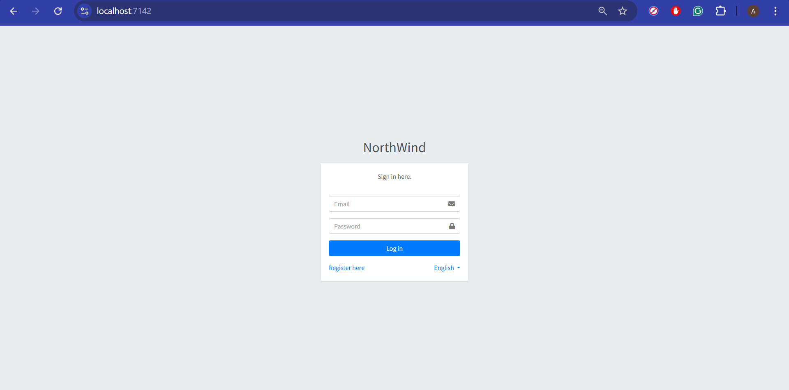
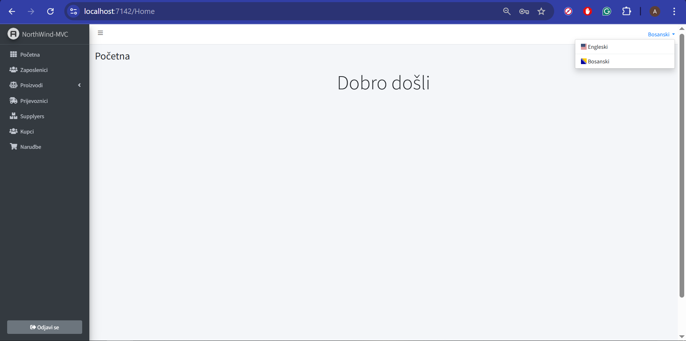
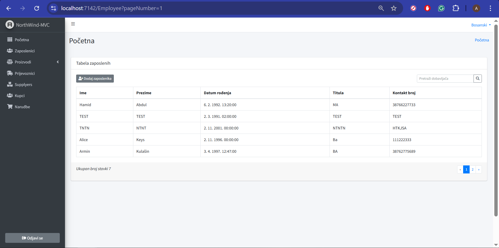
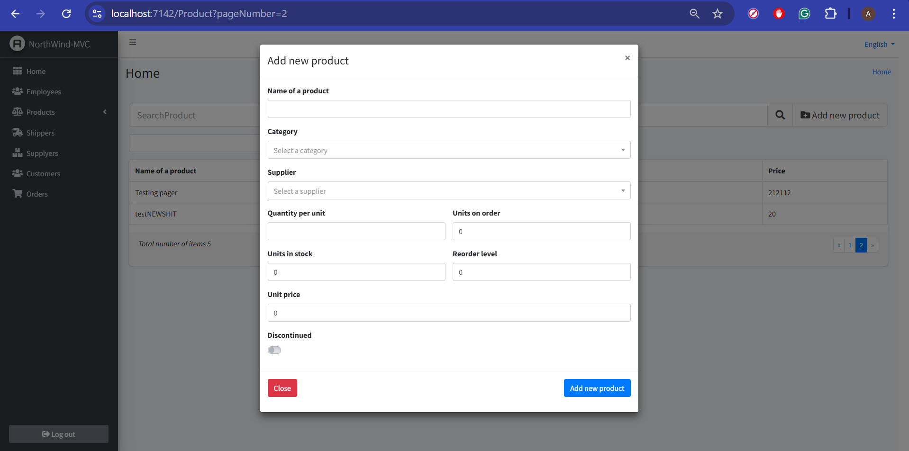

# 🏢 NorthWind-Inspired Management System (MVC)

An enterprise dashboard for managing business entities inspired by the Northwind model and built with **ASP.NET Core MVC**.

## Project Preview

### Secure Gatekeeper
A simple Authentication & Authorization system. Access to the dashboard and business data is restricted to registered users only.

### Dashboard & Multi-Language Support
The UI supports real-time **Localization (English & Bosnian)**.

| Employee Management & Search | Product Add/Edit Modal |
| :---: | :---: |
|  |  |

---

## Tech Stack
* **Backend:** ASP.NET Core MVC (C#)
* **Database:** PostgreSQL (Custom Schema via Entity Framework Core)
* **Frontend:** Razor Pages, CSS, JavaScript (jQuery for Search & Modals)
* **Identity:** ASP.NET Core Identity for secure Login/Register

## Roadmap
- [ ] **Orders Module:** WORK IN PROGRESS

---

## Setup Instructions
1. Clone the repository.
2. Update the connection string in `appsettings.json` to point to your local PostgreSQL instance.
3. Run `Update-Database` in the Package Manager Console to generate the custom schema.
4. Press **F5** to launch the application.